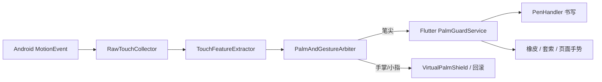
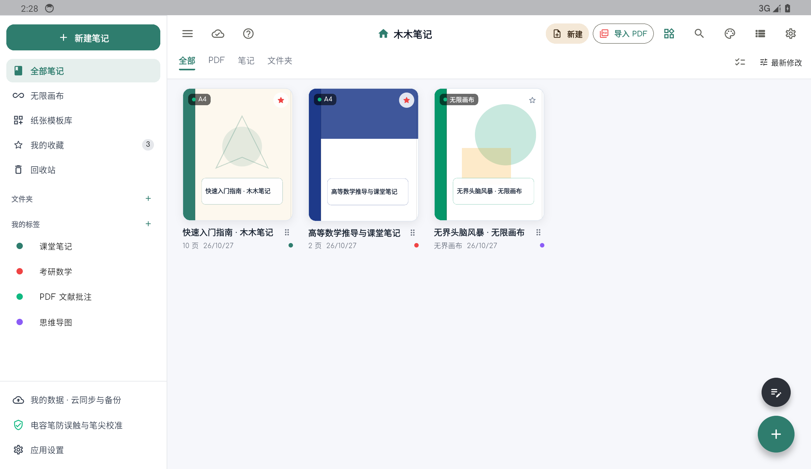
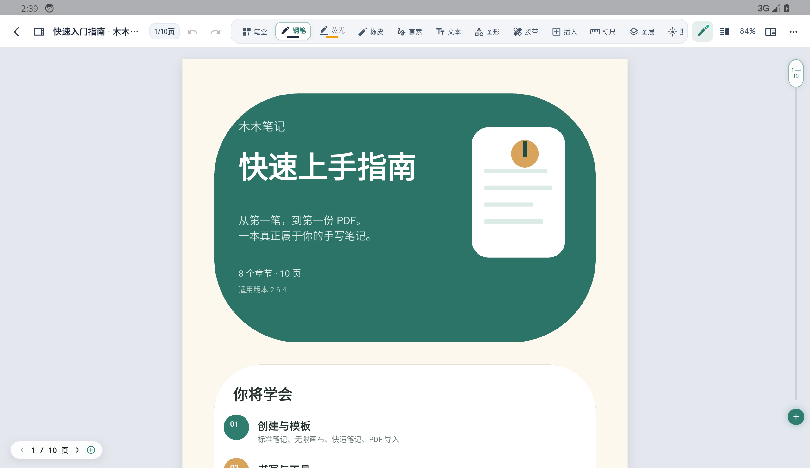
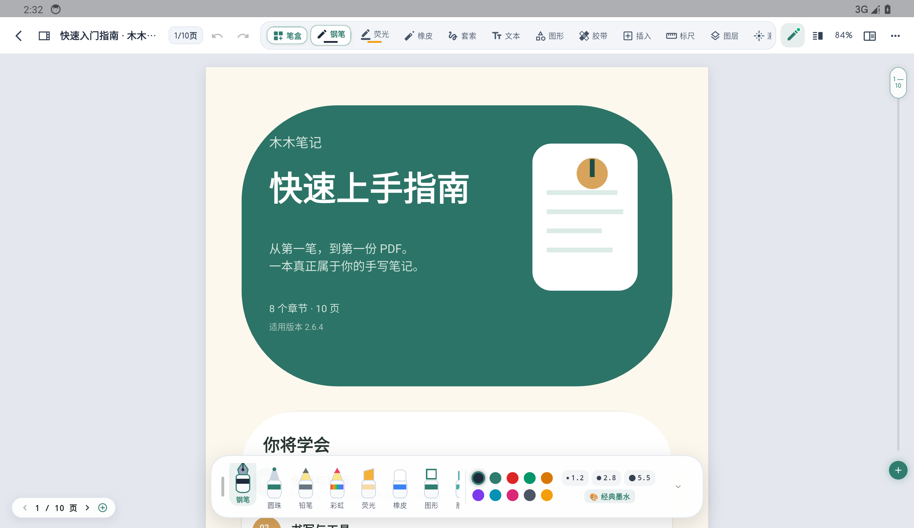
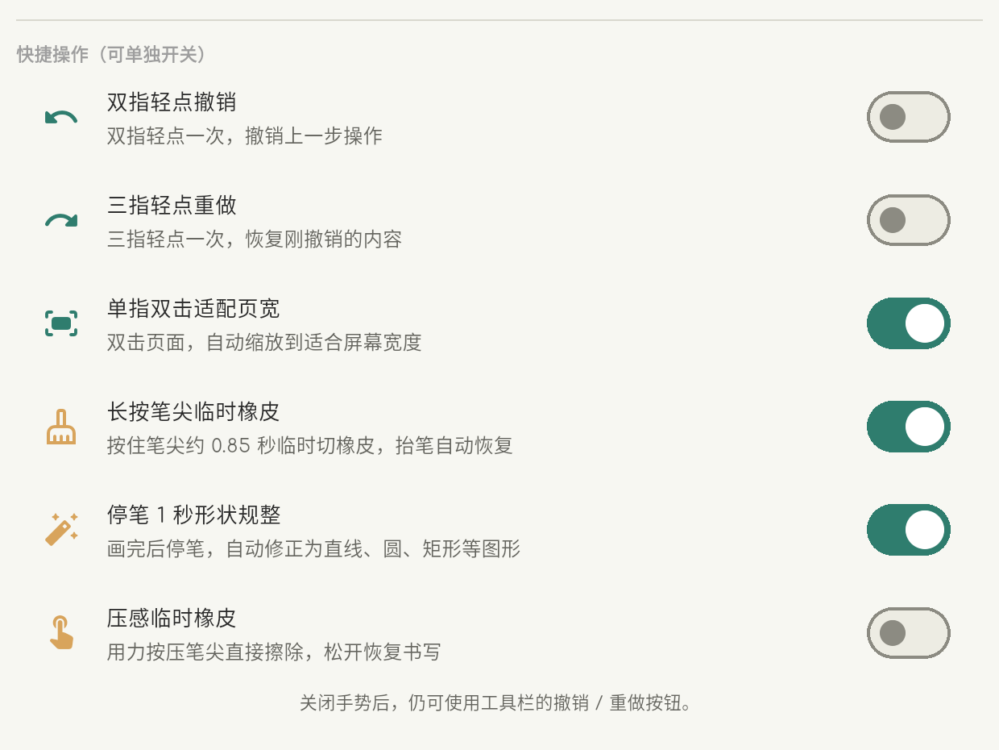
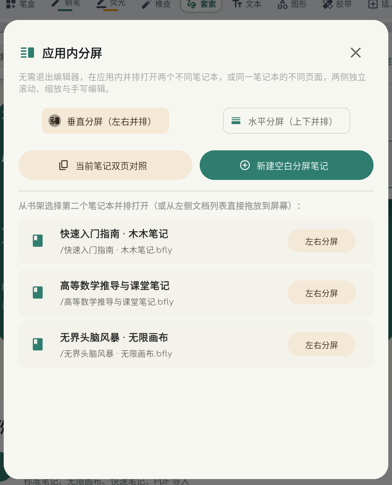
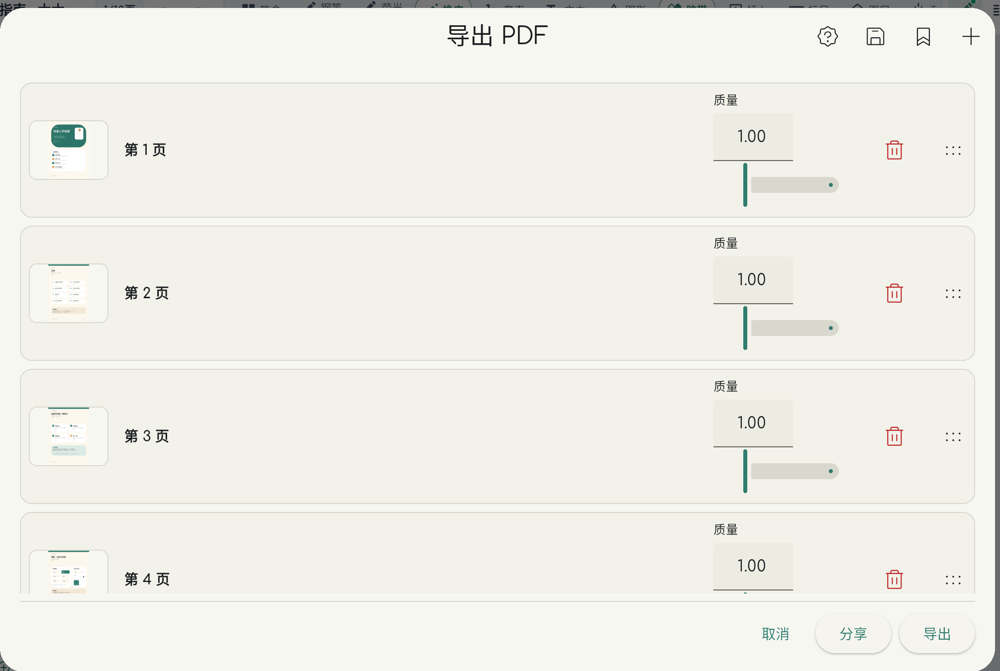
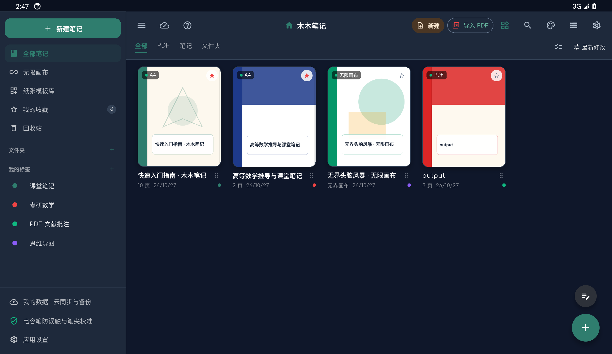

<p align="center">
  
</p>

<h1 align="center">木木笔记 · Mumu Notes</h1>

<p align="center">
  <b>面向 Android 平板的手写笔记与 PDF 批注应用</b><br>
  基于 Flutter，核心创新是面向普通电容笔的 PalmGuard 防触碰引擎。
</p>

<p align="center">
  
  
  
</p>

---

## 项目基底

木木笔记是 **Linwood Butterfly 2.6.2** 的 GPL-3.0 衍生项目，使用 Flutter / Dart 构建。

- 上游项目：[LinwoodDev/Butterfly](https://github.com/LinwoodDev/Butterfly)
- 上游版本：Butterfly 2.6.2
- 许可证：GNU General Public License v3.0，见 [`LICENSE`](LICENSE)
- 上游版权：Copyright © Linwood and Butterfly contributors
- 完整归属说明：[`ATTRIBUTION.md`](ATTRIBUTION.md)

我们保留上游的 `LICENSE`、`BRANDING_LICENSE` 和版权声明，并按 GPL-3.0 公开修改后的源代码。木木笔记与 **Notein（一笔记）没有任何关联**，未使用其商标、图标或截图素材。

## 最大创新点：PalmGuard 防触碰引擎

普通电容笔没有蓝牙协议、没有压感、没有笔尖 ID，Android 平板只能把它当成一根手指。手掌一贴屏，就会出现乱线、误触、橡皮误擦和页面乱跳。

PalmGuard 是木木笔记独立实现的输入仲裁层，目标不是“简单忽略大触点”，而是**在真实书写过程中区分笔尖、手指、手掌、侧掌和小指，并让误触不留下任何痕迹**。

### 输入管线



### 关键机制

- **接触几何判定**：读取触点等效直径、长短轴偏心率、压力、移动速度、曲率和面积膨胀率，区分笔尖与掌根。
- **阈值分级**：默认笔尖上限 `4.2 mm`、手掌硬阈值 `11.5 mm`；校准实验室可根据设备屏幕 PPI 和笔尖实际直径重新采集。
- **主动笔 400 ms 护盾**：主动笔落笔后 400 ms 内，所有手指/手掌触点直接拦截，避免手掌先落屏造成开笔断线。
- **160 ms 幽灵笔迹回滚**：小指或侧掌比真笔尖早落屏时，自动取消这段时间内产生的候选笔画，防止页边出现短横线。
- **手掌锚点与姿态扇区**：记录手掌首次落点，后续在右下方余波扇区内的触点优先判定为手掌；支持右手、左手、内勾、平放等握姿预设。
- **强书写锁定**：真实书写建立后，并发手掌触点免疫，不会把正在写的笔画打断。
- **虚拟防误触手垫**：在屏幕下方预设吸收区，托腕、搭手不会落墨。
- **自适应与滤波**：EMA 自适应笔尖均值、One-Euro 滤波、无压感笔锋模拟，让普通电容笔的线条更稳定。
- **双框校准实验室**：分别采集笔尖和手掌特征，实时显示判定结果、阈值和拒绝原因。
- **可关闭的快捷手势**：双指轻点撤销、三指轻点重做、单指双击适配页宽、长按临时橡皮、停笔形状规整、压感临时橡皮，都可以在 `··· > 快捷操作` 中单独开关并持久化。

### 代码位置

| 模块 | 路径 |
|---|---|
| Flutter 防触碰服务 | [`app/lib/services/palm_guard_service.dart`](app/lib/services/palm_guard_service.dart) |
| 原生 Android 防触碰模块 | [`app/android/palm-guard/`](app/android/palm-guard/) |
| 触点特征提取 | `app/android/palm-guard/src/main/java/com/mumunotes/core/touch/TouchFeatureExtractor.kt` |
| 笔/掌仲裁 | `app/android/palm-guard/src/main/java/com/mumunotes/core/touch/PalmAndGestureArbiter.kt` |
| 虚拟手垫 | `app/android/palm-guard/src/main/java/com/mumunotes/core/touch/VirtualPalmShield.kt` |
| Flutter 输入接入 | [`app/lib/views/view/input.dart`](app/lib/views/view/input.dart) |
| 笔迹提交与回滚 | [`app/lib/handlers/pen.dart`](app/lib/handlers/pen.dart) |

### 和其他笔记应用的区别

多数应用只按“接触面积大于某个值”来拒绝手掌，遇到小面积侧掌、小指先落屏、手掌缓慢压屏时仍会误触。PalmGuard 把**几何、时间、空间扇区、书写锁定和历史回滚**放在同一条输入管线里处理，因此可以在不依赖专用硬件协议的情况下，让普通电容笔获得接近主动笔的书写稳定性。

## 功能

- 手写：钢笔、圆珠笔、铅笔、彩虹笔、荧光笔、图形、激光笔、橡皮
- 纸面：A4 / A5 / 平板 / 自定义尺寸，横线、方格、点阵、康奈尔、法务线
- 页面：纵向连续滚动、页间插入、页底上滑加页、平铺缩略图、页面旋转
- PDF：整本导入、逐页批注、原文层与手写层分离、导出完整 PDF
- 对象：套索 / 矩形套索、移动、缩放、删除、文本框、胶带背诵
- 组织：多图层、大纲、批注、双向链接、应用内分屏、双页对照
- 快捷操作：可单独开关的双指撤销、三指重做、双击适配页宽、长按临时橡皮等
- 中文界面：严格简体中文，支持浅色 / 深色 / 跟随系统

## 截图

| 书架 | 编辑器 |
|---|---|
|  |  |

| 笔盒 | 快捷操作 |
|---|---|
|  |  |

| 应用内分屏 | 导出 PDF |
|---|---|
|  |  |

<p align="center">
  
</p>

## 下载

最新安装包与说明书：

- [GitHub Releases](https://github.com/notevenwronglx-maker/mumu-notes/releases/latest)
- 使用说明：[`app/defaults/manual.pdf`](app/defaults/manual.pdf)

APK 选择：

- `arm64-v8a`：绝大多数 Android 平板
- `armeabi-v7a`：较老的 32 位设备
- `x86_64`：Android 模拟器

## 构建

环境要求：

- Flutter 3.47.x
- JDK 17
- Android SDK 36
- Android minSdk 24

```bash
cd app
flutter pub get
flutter gen-l10n
flutter build apk --release --flavor production --split-per-abi
```

产物在 `app/build/app/outputs/flutter-apk/`。

## 目录

```text
.
├─ app/                 Flutter 应用
│  ├─ lib/              界面、输入、渲染、文档模型接入
│  ├─ android/          Android 工程与 palm-guard 原生模块
│  ├─ defaults/         内置说明书 PDF 等默认资源
│  └─ ...
├─ api/                 笔记数据模型与协议
├─ packages/            本地依赖
├─ docs/                README 截图与补充文档
├─ LICENSE              GPL-3.0
├─ BRANDING_LICENSE     上游品牌许可
└─ ATTRIBUTION.md       上游归属与修改说明
```

## 许可证与归属

木木笔记按 **GPL-3.0** 发布，基于 Linwood Butterfly 2.6.2 修改。原始版权归 Linwood 及 Butterfly contributors 所有；木木笔记新增的界面、PalmGuard 防触碰模块、PDF 工作流和中文内容由木木笔记贡献者维护。

如果你分发修改后的版本，请同时保留 `LICENSE`、`BRANDING_LICENSE` 和 `ATTRIBUTION.md`，并提供对应的完整源代码。